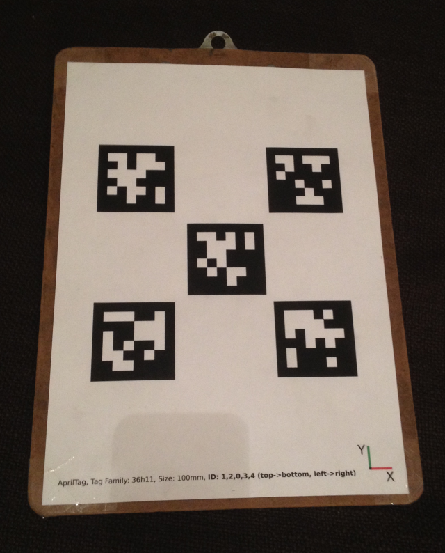
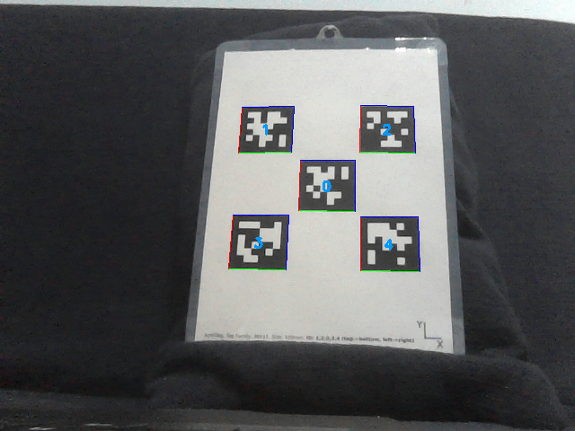

## Overview


The package works as shown in the above figure. The following default
input topics are subscribed to (which can be remapped based on your
needs):

- `/camera_rect/image_rect`: a
  [sensor_msgs/msg/Image](https://docs.ros.org/en/rolling/p/sensor_msgs/msg/Image.html)
  topic which contains the image (e.g. a frame of a video stream coming
  from a camera). *The image is assumed to be undistorted, i.e. produced
  by a pinhole camera*. Laptop webcams typically already provide such an
  image while other cameras may require undistortion by an intermediate
  node such as [image_proc](https://index.ros.org/p/image_proc);
- `/camera_rect/camera_info`: a
  [sensor_msgs/msg/CameraInfo](https://docs.ros.org/en/rolling/p/sensor_msgs/msg/CameraInfo.html)
  topic which contains the camera calibration matrix in
  `/camera/camera_info/K`. One can obtain a specific camera's `K`
  via camera intrinsics calibration using e.g.
  [camera_calibration](https://index.ros.org/p/camera_calibration) or
  [Kalibr](https://github.com/ethz-asl/kalibr) (the former seemed to
  work better for laptop webcam calibration).

The behavior of the ROS wrapper is fully defined by the two
configuration files `config/tags.yaml` (which defines the tags and tag
bundles to look for) and `config/settings.yaml` (which configures the
core !AprilTag 2 algorithm itself). Then, the following topics are
output:

- `/tf`: relative pose between the camera frame and each detected
  tag's or tag bundle's frame (specified in `tags.yaml`) using
  [tf](https://index.ros.org/p/tf). Published only if `publish_tf:
  true` in `config/settings.yaml`;
- `/tag_detections`: the same information as provided by the `/tf`
  topic but as a custom message carrying the tag ID(s), size(s) and
  [geometry_msgs/msg/PoseWithCovarianceStamped](https://docs.ros.org/en/rolling/p/geometry_msgs/msg/PoseWithCovarianceStamped.html)
  pose information (where plural applies for tag bundles). This is
  always published;
- `/tag_detections_image`: the same image as input by
  `/camera/image_rect` but with the detected tags highlighted.
  Published only if `publish_tag_detections_image==true` in
  `launch/continuous_detection.launch`.

## Tutorials

The [tutorials](#tutorials-1) teach you how to
operate the wrapper. The main idea is to fill out `config/tags.yaml`
with the standalone tags and tag bundles which you would like to detect
(bundles potentially require a calibration process) and
`config/settings.yaml` with the wrapper and !AprilTag 2 core
parameters. Then, you simply run the continuous or single image
detector. The tutorials walk you through how to do this.

## Citing

While this ROS wrapper is original code originating from the author's
master thesis, the core !AprilTag 2 algorithm in `apriltags2/` is
wholly the work of the
[APRIL Robotics Lab](https://april.eecs.umich.edu/software/apriltag.html)
at The University of Michigan. If you use this package, please kindly
cite:

- D. Malyuta,
  "[Navigation, Control and Mission Logic for Quadrotor Full-cycle Autonomy](https://www.research-collection.ethz.ch/handle/20.500.11850/248154),"
  Master thesis, Jet Propulsion Laboratory, 4800 Oak Grove Drive,
  Pasadena, CA 91109, USA, December 2017.
- J. Wang and E. Olson,
  "[AprilTag 2: Efficient and robust fiducial detection](http://ieeexplore.ieee.org/document/7759617/),"
  in *Proceedings of the IEEE/RSJ International Conference on
  Intelligent Robots and Systems (IROS)*, October 2016.


```
@mastersthesis{malyuta:2017mt,
  author = {Danylo Malyuta},
  title = {{Guidance, Navigation, Control and Mission Logic for Quadrotor Full-cycle Autonomy}},
  language = {english},
  type = {Master thesis},
  school = {Jet Propulsion Laboratory},
  address = {4800 Oak Grove Drive, Pasadena, CA 91109, USA},
  month = dec,
  year = {2017}
}
@inproceedings{Wang2016,
  author = {Wang, John and Olson, Edwin},
  booktitle = {2016 IEEE/RSJ International Conference on Intelligent Robots and Systems (IROS)},
  doi = {10.1109/IROS.2016.7759617},
  isbn = {978-1-5090-3762-9},
  month = {oct},
  pages = {4193--4198},
  publisher = {IEEE},
  title = {{AprilTag 2: Efficient and robust fiducial detection}},
  year = {2016}
}
```


## Nodes


```clearsilver
node.0{
  name = apriltag_ros
  desc = Detector for a continuous image (i.e. video) stream.
  sub {
    0.name = image_rect
    0.type = sensor_msgs/Image
    0.desc = Undistorted image (i.e. produced by a pinhole camera)
    1.name = camera_info
    1.type = sensor_msgs/CameraInfo
    1.desc = Camera information, used only for the camera calibration matrix `K`
  }
  pub {
    0.name = tag_detections
    0.type = apriltag_ros/AprilTagDetectionArray
    0.desc = Array of tag and tag bundle detections' pose relative to the camera
    1.name = tag_detections_image
    1.type = sensor_msgs/Image
    1.desc = Same as `image_rect` but with the detected tags highlighted
  }
  prov_tf {
    0.from = tag
    0.to = camera
    0.desc << EOM
Relative pose of the camera frame to the tag frame. The tag frame here is a placeholder for a standalone tag frame or a tag bundle frame and the specific name can be specified in `config/tags.yaml` or will be set automatically to `tag_ID` or `bundle_COUNT` if ommitted. There will be as many of these transforms as there are specified tags and tag bundles in `config/tags.yaml`.
EOM
  }
  param {
    0.name = tag_family
    0.type = string
    0.desc = !AprilTag family to use for detection. Supported: `tag36h11`, `tag36h10`, `tag25h9`, `tag25h7` and `tag16h5`.
    0.default = `tag36h11`
    1.name = tag_border
    1.type = int
    1.desc = Width of the tag outer (circumference) black border
    1.default = 1
    2.name = tag_threads
    2.type = int
    2.desc = How many threads should the !AprilTag 2 core algorithm use?
    2.default = 4
    3.name = tag_decimate
    3.type = double
    3.desc << EOM
Detection of quads can be done on a lower-resolution image, improving speed at a cost of pose accuracy and a slight decrease in detection rate. Decoding the binary payload is still done at full resolution. .
EOM
    3.default = 1.0
    4.name = tag_blur
    4.type = double
    4.desc << EOM
What Gaussian blur should be applied to the segmented image (used for quad detection?)  Parameter is the standard deviation in pixels.  Very noisy images benefit from non-zero values (e.g. 0.8).
EOM
    4.default = 0.0
    5.name = tag_refine_edges
    5.type = int
    5.desc << EOM
When non-zero, the edges of the each quad are adjusted to "snap to" strong gradients nearby. This is useful when decimation is employed, as it can increase the quality of the initial quad estimate substantially. Generally recommended to be on (1). Very computationally inexpensive. Option is ignored if `tag_decimate==1.0`.
EOM
    5.default = 1
    6.name = tag_refine_decode
    6.type = int
    6.desc << EOM
When non-zero, detections are refined in a way intended to increase the number of detected tags. Especially effective for very small tags near the resolution threshold (e.g. 10px on a side).
EOM
    6.default = 0
    7.name = tag_refine_pose
    7.type = int
    7.desc << EOM
When non-zero, detections are refined in a way intended to increase the accuracy of the extracted pose. This is done by maximizing the contrast around the black and white border of the tag. This generally increases the number of successfully detected tags, though not as effectively (or quickly) as `tag_refine_decode`.
EOM
    7.default = 0
    8.name = publish_tf
    8.type = bool
    8.desc = Enable publishing the tag-camera relative poses on the `/tf` topic
    8.default = false
    9.name = camera_frame
    9.type = string
    9.desc = Camera frame name
    9.default = camera
    10.name = publish_tag_detections_image
    10.type = bool
    10.desc = Enable publishing on the `/tag_detections_image` topic
    10.default = false
  }
}
node.1{
  name = apriltag_ros_single_image_server
  desc << EOM
Detector of tags in a single provided image (via a ROS service which it serves). This is useful for e.g. analyzing a single frame of a video stream (which you maybe think had a faulty tag detection). Starting with, as a baseline, the same description as the [[apriltag_ros#apriltag_ros-1|apriltag_ros node]], this node does not subscribe to any topics, does not output the `/tag_detections_image` topic (the output image is saved in an image save filepath as described below) and does not use the parameters `camera_frame` and `publish_tag_detections_image`. The information below describes additional features of this node.
EOM
  srv {
    0.name = single_image_tag_detection
    0.type = apriltag_ros/AnalyzeSingleImage
    0.desc << EOM
Takes in the '''absolute''' file path of the input image to detect tags in, the '''absolute''' file path where to store the output image (same as input image, with detected tags highlighted) and the camera intrinsics (in particular, the `K` matrix). Returns an <<MsgLink(apriltag_ros/AprilTagDetectionArray)>> of the detected tags' and tag bundles' poses.
EOM
  }
}
node.2{
  name = apriltag_ros_single_image_client
  desc << EOM
A client for the single image tag detection service provided by the [[apriltag_ros#apriltag_ros_single_image_server|apriltag_ros_single_image_server node]]. This node is developed specifically for interacting with this service. Starting with, as a baseline, the same description as the [[apriltag_ros#apriltag_ros-1|apriltag_ros node]], this node does not subscribe to any topics, does not publish any topics and does not use the parameters `camera_frame` and `publish_tag_detections_image`. The information below describes additional features of this node.
EOM
  srv_called {
    0.name = single_image_tag_detection
    0.type = apriltag_ros/AnalyzeSingleImage
    0.desc = See the above description of the `single_image_tag_detection` service provided by the [[apriltag_ros#apriltag_ros_single_image_server|apriltag_ros_single_image_server node]]
  }
  param {
    0.name = image_load_path
    0.type = string
    0.desc = '''Absolute''' file path of the image to detect tags in
    1.name = image_save_path
    1.type = string
    1.desc = '''Absolute''' file path where to save the image with the detected tags highlighted
    2.name = fx
    2.type = double
    2.desc = Camera x focal length (in [px])
    3.name = fy
    3.type = double
    3.desc = Camera y focal length (in [px])
    4.name = cx
    4.type = double
    4.desc = Camera image principal point x coordinate (in [px])
    5.name = cy
    5.type = double
    5.desc = Camera image principal point y coordinate (in [px])
  }
}
```

## Tutorials

The following tutorials teach you how to use this package. Note that the
theory behind how this package works (e.g. tag and bundle pose
estimation, bundle calibration, etc.) is explained in the
[originating thesis](https://www.research-collection.ethz.ch/TODO). The
general concept itself (e.g. input/output behaviour) is explained
directly in the
apriltag_ros package description.

- [Bundle Calibration](#bundle-calibration):
  This tutorial teaches you how to calibrate a tag bundle for inclusion
  in `config/tags.yaml`.
- [Detection in a Single Image](#detection-in-a-single-image):
  This tutorial teaches you how to use this package for tag and tag
  bundle detection in a single image.
- [Detection in a Video Stream](#detection-in-a-video-stream):
  This tutorial teaches you how to use this package for tag and tag
  bundle detection in a video stream.

## Bundle Calibration

A tag bundle is a collection of !AprilTags that are used simulataneously
in order to extract a single "bundle pose", rather than the poses of
the individual tags. This is useful when a more accurate and precise
pose estimate is required since bundle pose estimation makes use of
every detected tags' corners (making for `4n` points if `n` tags
are detected) rather than single tag pose estimation, which only uses 4
points corresponding to the 4 tag corners.

*Bundle calibration* is the determination of the relative pose of each
tag with respect to the bundle frame. When you print the bundle on a
single sheet of paper, you might know these relative poses exactly and
calibration described herein is not necessary (you can fill out
`config/tags.yaml` directly). However, when you lay out individual
tags arbitrarily, the calibration herein allows to automatically
determine the relative poses. For the theory behind this calibration,
please refer to Section 3.1.4 of
[this report](https://doi.org/10.3929/ethz-b-000248154).


```wiki
'''DANGER!!!''' Calibration accuracy strongly effects bundle detection accuracy. When you know the exact calibration (i.e. the bundle is arranged in a known precise fashion because it is e.g. printed on a single sheet of paper), use it instead of running this calibration. When you do run the calibration herein, '''ensure that bundle detection is accurate for an exhaustive number of bundle-camera relative poses'''. A common failure mode associated with a poor calibration is for the pose estimate to be "mirrored" (i.e. as if the bundle is behind the camera) for certain "unfortunate" bundle-camera relative poses.
```


### Collecting Calibration Data

The first step in the calibration process is to collect the raw data in
the form of a ROS [bag](Bags). Let's assume without loss of generality
that we are calibrating the following tag bundle:



In this case, the bundle consists of tags of the family 36h11 with IDs
0, 1, 2, 3 and 4 that are all 50mm in side length. Fill out
`config/tags.yaml` like so:


```
standalone_tags:
  [
    {id: 0, size: 0.05},
    {id: 1, size: 0.05},
    {id: 2, size: 0.05},
    {id: 3, size: 0.05},
    {id: 4, size: 0.05}
  ]
tag_bundles:
  [
  ]
```


Note that it is not an issue if there are more tags specified in
`config/tags.yaml` as long as these ones are present with the correct
side lengths in the `standalone_tags` list. Make sure that
`config/settings.yaml` also sets the correct parameter values (e.g.
`tag_family: 'tag36h11'` here). The idea is that we are now
collecting the pose estimates of the individual tags with respect to the
camera.

For this tutorial and without loss of generality we shall choose the
center tag with ID 0 to be the *master tag*. The master tag's frame
defines the bundle frame. If your bundle frame does not coincide with
one of the constituent tags, add an extra tag just for the calibration
to act as the master tag (you can remove it afterwards).

Position the camera in front of the bundle such that all constituent
tags are visible. Keep the camera still during the data collection
process. Now run the continuous tag detector:


```
$ roslaunch apriltags2_ros continuous_detection.launch
```


As explained in the [apriltags2_ros overview](apriltags2_ros#Overview),
it is of course assumed that you have set up your camera corretly to
publish on the camera image input topics subscribed to by the continuous
detector. A typical `/tag_detections_image` during the calibration
looks like this:



Now run the following command to record the raw calibration data in the
`scripts/data` directory:


```
$ rosbag record -O calibration /tag_detections
```


Keep recording until, heuristically speaking, about 500
`/tag_detections` messages are collected. If the `/tag_detections`
topic is published at e.g. 10 Hz (this depends on how powerful your
computer is and your choices in `config/settings.yaml`), then this
means you should run the recording for roughly 1 minute.

In summary, you now have a raw calibration data bagfile with the file
path `scripts/data/clibration.bag`. As far as calibration is
concerned, you can now shut down ROS (the rest is MATLAB).

### Running the Calibration

Open MATLAB and navigate to `scripts/`. Open `calibrate_bundle.m`
for editing and set the `master_id` in the `User inputs` section to
your calibration's master tag's ID. Here, we set `master_id = 0`.
You can also set a custom bundle name and optionally a differently named
`.bag` file to use for the raw calibration data. Now run in the
command window:


```
>> calibrate_bundle
```


On first execution, the script will download and set up
[matlab_rosbag](https://github.com/bcharrow/matlab_rosbag) for reading
ROS bag files in MATLAB. Then, the calibration script will run and an
entry of `tag_bundles` will be printed out. For the bundle used in
this tutorial, the following is printed:


```
tag_bundles:
  [
    {
      name: 'my_bundle',
      layout:
        [
          {id: 0, size: 0.05, x: 0.0000, y: 0.0000, z: 0.0000, qw: 1.0000, qx: 0.0000, qy: 0.0000, qz: 0.0000},
          {id: 4, size: 0.05, x: 0.0548, y: -0.0522, z: -0.0057, qw: 1.0000, qx: 0.0063, qy: -0.0016, qz: 0.0010},
          {id: 3, size: 0.05, x: -0.0580, y: -0.0553, z: 0.0015, qw: 1.0000, qx: -0.0039, qy: -0.0006, qz: 0.0016},
          {id: 2, size: 0.05, x: 0.0543, y: 0.0603, z: -0.0043, qw: 1.0000, qx: -0.0016, qy: 0.0082, qz: 0.0018},
          {id: 1, size: 0.05, x: -0.0582, y: 0.0573, z: 0.0012, qw: 1.0000, qx: -0.0057, qy: -0.0028, qz: 0.0006}
        ]
    }
  ]
```


You can directly copy this entry into `config/tags.yaml`. Note that,
naturally, the master tag (here tag ID 0) has zero translation and
identity quaternion attitude with respect to itself.

## Detection in a Single Image

The single image detector detects tags and tag bundles in a single
image. A typical use case is to check detections in a single frame of a
video stream, which you maybe think is problematic.

### Parameter Setup

The setup is of `config/settings.yaml` and `config/tags.yaml` is
identical to the
[video stream detector](apriltags2_ros/Tutorials/Detection%20in%20a%20video%20stream#Parameter_setup).

#### launch/single_image_client.launch

Here you must set the camera intrinsics `fx`, `fy`, `cx` and
`cy` (their meanings are given in the
[single image client interface description](apriltags2_ros#apriltags2_ros_single_image_client)).
You obtain these parameters typically from a camera intrinsics
calibration (e.g.
[camera_calibration](https://index.ros.org/p/camera_calibration), which
seems to work better for webcams, or
[Kalibr](https://github.com/ethz-asl/kalibr)).

### Run the Detector

The single image detector is based on a ROS service. You provide a file
path to the image, the server runs it through the !AprilTag detector
(the same one as the video stream node) and provides you the detection
results and saves an output image. The server publishes the results on
the same topics as the video stream detector, however
`/tag_detections_image` is not published (rather, it is saved as an
output image). Begin by running the service's server node:


```
$ roslaunch apriltags2_ros single_image_server.launch
```


Now you can run the client in order to detect tags and tag bundles in
your image:


```
$ roslaunch apriltags2_ros single_image_client.launch image_load_path:=<FULL PATH TO INPUT IMAGE> image_save_path:=<FULL PATH TO OUTPUT IMAGE>
```


PNG images work well (others may work too, but have not been tested).
The client will run, you will see the server print out `Done!` if
everything is successful, and the client will then quit (the server will
continue running, waiting for another single image detection service
call). The output image will be at your indicated output image path. If
you have `tag_debug: 1` in `config/settings.yaml`, then the
intermediate !AprilTag 2 algorithm's image processing images will be
found in `/.ros` as `\*.pnm` image files (where `` is your home
directory).

## Detection in a Video Stream

```wiki
'''Note''': For the tag pose estimation to work properly, your `camera_info` topic must be appropriately set with your camera calibration parameters (see this [[https://github.com/dmalyuta/apriltags2_ros/issues/3|Github issue]]).
```


The most common use case for this package is to detect tags in a
continuous stream of images (video frames) coming from a camera. This
tutorial teaches you how to do this.

### Parameter Setup

#### config/settings.yaml

This file sets parameters for the core !AprilTag 2 algorithm and for the
ROS wrapper. Use it in order to set these parameters. In particular:

- Make sure that the `tag_family` is correct for the tags that you're
  using. The !AprilTag 2 algorithm does not support simultaneous
  detection of multiple tag families;
- Make sure `tag_border` corresponds to your tags' black border bit
  width (typically 1 - each square in the tag is represents 1 bit);
- Setting `tag_threads` allows certain parts of the core !AprilTag 2
  algorithm to run parallel computations. Typical multithreading
  advantages and limitations apply;
- Setting `tag_decimate>1` allows to decimate (reduce the resolution)
  of the image by that amount. This makes the core !AprilTag 2 algorithm
  faster (there are less pixels to process) but means that smaller tags
  are less likely to be detected. Pose estimation and decoding still
  happens with the full-resolution image;
- Setting `tag_blur>0` blurs the image and `tag_blur<0` sharpens
  the image;
- Setting `tag_refine_edges=1` improves the detection fit to the tag,
  thus the corner detection precision, thus the pose estimation
  accuracy. Not computationally expensive and recommended to be on (1);
- Setting `tag_refine_decode=1` reducecs the false negative detetion
  rate;
- Setting `tag_refine_pose=1` improves the estimated pose accuracy but
  is computationally expensive;
- Setting `tag_debug=1` will save the !AprilTag 2 algorithm's
  intermediate images into `/.ros`. This is useful for debugging a bad
  detection and should be used typically only with the
  [single image detector](apriltags2_ros/Tutorials/Detection%20in%20a%20Single%20Image);
- Setting `publish_tf=true` will publish the detected tags' and tag
  bundles' poses over the `/tf` topic, meaning that they can be
  visualized in e.g. [rviz](https://index.ros.org/p/rviz).

#### config/tags.yaml

This file defines the standalone tags and tag bundles that should be
looked for in the input image. Rogue tags (i.e. those that are not
defined in `config/tags.yaml`) will be ignored. **IMPORTANT**:

- No tag ID should appear twice with different sizes (this creates
  ambiguity in the detection);
- No tag ID should appear twice in the image (this creates ambiguity in
  the detection);
- It is fine for a tag with the same ID to be listed both in
  `standalone_tags` and in `tag_bundles`, as long as it has the same
  size.

Furthermore, **make sure that you print yours tags surrounded by at
least a 1 bit wide white border**. The core !AprilTag 2 algorithm
samples this surrounding white border for creating a light model over
the tag surface so do not e.g. cut or print the tags out flush with
their black border.

The `tag_bundles` are filled out with the relative poses of the
constituent tags to the bundle origin. Sometimes you may know these
transforms (e.g. you print the bundle on a single sheet of paper where
you lay out the tags in a known fashion). When you do not know these
relative poses (e.g. you stick individual tags roughly on the
floor/wall), perform a
[calibration](apriltags2_ros/Tutorials/Bundle%20calibration) to easily
determine them.

#### launch/continuous_detection.launch

The launch file provides an opportunity to set a few more parameters.
Here, the camera name and image topic can be remapped to your
implementation. Furthermore, you can set the
`publish_tag_detections_image=false` in order to not publish the
`/tag_detections_image` (more efficient if you do not care to see an
image with the detected tags highlighted).

### Run the Detector

With the parameters correctly configured and the camera image stream
being published, running the detector is trivial:


```
$ roslaunch apriltags2_ros continuous_detection.launch
```


#### Example

Consider the following `config/settings.yaml`:


```
tag_family:        'tag36h11'
tag_border:        1 
tag_threads:       2 
tag_decimate:      1.0 
tag_blur:          0.0 
tag_refine_edges:  1 
tag_refine_decode: 0 
tag_refine_pose:   0 
tag_debug:         0 
publish_tf:        true
```


Consider the following `config/tags.yaml`:


```
standalone_tags:
  [
    {id: 10, size: 0.15},
    {id: 20, size: 0.1},
    {id: 30, size: 0.07}
  ]
tag_bundles:
  [
    {
      name: 'my_bundle',
      layout:
        [
          {id: 0, size: 0.05, x: 0.0000, y: 0.0000, z: 0.0, qw: 1.0, qx: 0.0, qy: 0.0, qz: 0.0},
          {id: 4, size: 0.05, x: 0.0548, y: -0.0522, z: 0.0, qw: 1.0, qx: 0.0, qy: 0.0, qz: 0.0},
          {id: 3, size: 0.05, x: -0.0580, y: -0.0553, z: 0.0, qw: 1.0, qx: 0.0, qy: 0.0, qz: 0.0},
          {id: 2, size: 0.05, x: 0.0543, y: 0.0603, z: 0.0, qw: 1.0, qx: 0.0, qy: 0.0, qz: 0.0},
          {id: 1, size: 0.05, x: -0.0582, y: 0.0573, z: 0.0, qw: 1.0, qx: 0.0, qy: 0.0, qz: 0.0}
        ]
    }
  ]
```


We start the camera (Dell XPS 13 9360 webcam with 640x480 \[px\]
resolution), the detector, run `rqt` and view the
`/tag_detections_image` and the detected tags' and tag bundles'
poses in `rviz` (thanks to `/tf`):

[Youtube](https://www.youtube.com/watch?v=fHhP12w6rNg)

With these settings, the detection runs at roughly 15-20 Hz on the Dell
XPS 13 9360 laptop with a 640x480 \[px\] resolution video stream.
According to Valgrind (Callgrind with KCachegrind), the performance
bottleneck is the core !AprilTag 2 algorithm.
